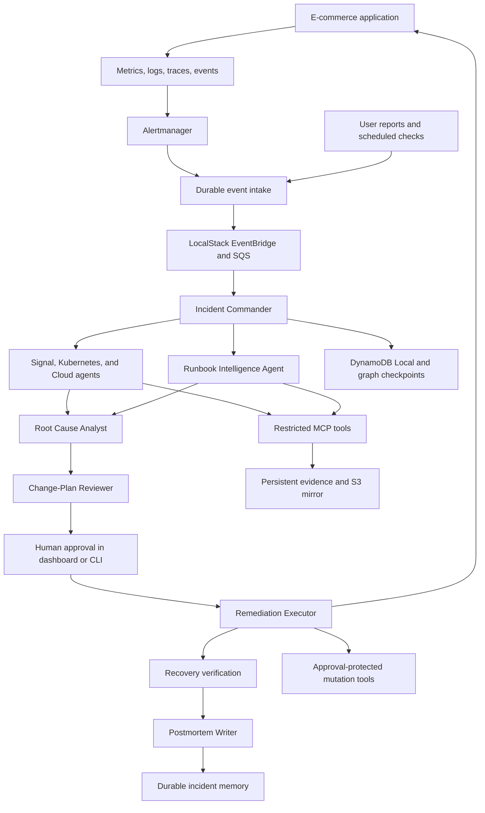

# AegisOps — End-to-End Implementation Plan

**Document:** `IMPLEMENTATION PLAN.md`  
**Source:** [PROJECT SCOPE.md](./PROJECT%20SCOPE.md)  
**Date:** September 29, 2026  
**Status:** Complete planning document. The project has not been implemented.

## 1. Outcome, decisions, and boundaries

Build a local, production-style incident-response platform that demonstrates the complete workflow:

**Detect → investigate → retrieve knowledge → identify root cause → review remediation → obtain human approval → execute → verify → report → remember.**

The finished release must let someone start the environment, inject any of the five failures, follow the investigation in a dashboard, approve a precise remediation, and inspect the recovery evidence. Repeating the secret incident must demonstrate useful persistent memory.

### Agreed decisions

| Area | Decision |
|---|---|
| Delivery | Complete local portfolio release; real AWS deployment belongs to the future roadmap. |
| Backend | Python, FastAPI, Pydantic, and LangGraph. |
| Frontend | React, TypeScript, Vite, and Tailwind CSS. |
| AI | OpenAI for live investigations; deterministic replay fixtures for routine tests. |
| Kubernetes | Kind, with Helm-managed deployments. |
| AWS simulation | LocalStack Hobby. Infrastructure must remain free. |
| Queue | SQS through LocalStack; do not introduce RabbitMQ or Kafka. |
| Application database | PostgreSQL. |
| Vector search | pgvector in a separate control-plane PostgreSQL instance. |
| Observability | Prometheus, Alertmanager, Grafana, Loki, Tempo, and OpenTelemetry Collector. |
| Initial platform | Linux x86-64, matching the development machine. |

The two PostgreSQL instances keep the database-exhaustion simulation from disrupting AegisOps itself. Redis is unnecessary initially: working context can live in graph state backed by durable checkpoints.

### Free LocalStack architecture

LocalStack Hobby is free, but its current feature table excludes local state persistence and IAM enforcement. The implementation must not depend on those paid features. [LocalStack plan comparison](https://docs.localstack.cloud/aws/licensing/)

Use:

- **LocalStack Hobby:** SQS, S3, Secrets Manager, and EventBridge simulations.
- **DynamoDB Local:** authoritative incident records, approvals, execution records, audit events, and long-term memory, using persistent disk storage. AWS documents a free local distribution and a Docker configuration with persistent storage. [DynamoDB Local documentation](https://docs.aws.amazon.com/amazondynamodb/latest/developerguide/DynamoDBLocal.DownloadingAndRunning.html)
- **Persistent local artifact storage:** durable copies of redacted evidence and reports, mirrored into LocalStack S3.
- **Application authorization and Kubernetes RBAC:** actual permission enforcement. Document that the Hobby configuration does not validate AWS IAM enforcement.

LocalStack still requires account setup and an authentication token. “One-command setup” begins after the user supplies that token and, for live AI mode, an OpenAI API key. [LocalStack authentication](https://docs.localstack.cloud/aws/getting-started/auth-token/)

### Release boundaries

Include every scoped incident scenario, all nine named agent roles, the dashboard, CLI, MCP tools, RAG, approvals, remediation, persistent memory, compaction, evaluations, and documentation.

Defer multi-tenant operation, enterprise SSO, high availability, arbitrary shell execution, production AWS access, and fully autonomous remediation. Describe the project as a production-style local demonstration, with its limitations stated clearly.

## 2. Architecture and system contracts

### Deployment architecture

Run the application, control plane, emulators, and observability stack inside one dedicated Kind cluster. Separate them into application, control-plane, and observability namespaces.

Use persistent host-backed volumes for durable data. Install Calico with Kind’s default CNI disabled so NetworkPolicies are actually enforced. [Calico installation on Kind](https://docs.tigera.io/calico/latest/getting-started/kubernetes/kind)

### Demonstration application

Implement a deliberately small application with real service interactions:

- `storefront`: product listing and checkout UI/API gateway.
- `checkout-service`: coordinates inventory and payment.
- `payment-service`: simulated payment provider that validates a synthetic API credential.
- `inventory-service`: uses PostgreSQL with a configurable connection pool.
- `notification-worker`: consumes order/payment events from SQS.
- A traffic generator that continuously exercises successful and failing requests.

Use synthetic orders, credentials, and payment data. Provide readiness probes, resource limits, structured logs, metrics, and trace propagation in every service.

Maintain deterministic failure controls in the simulation harness. Agents must discover faults through operational evidence; they must not receive the scenario’s expected answer.

### Agent responsibilities

The scope’s “Observability Agent” responsibilities are assigned to the named **Signal Correlation Agent**, keeping nine distinct roles.

| Agent | Responsibility | Operational authority |
|---|---|---|
| Incident Commander | Triage, dispatch investigations, track progress, enforce budgets. | Read and coordinate. |
| Signal Correlation Agent | Correlate metrics, logs, traces, and recent changes. | Read observability data. |
| Kubernetes Diagnostics Agent | Inspect workloads, events, rollout history, and configuration. | Read approved Kubernetes resources. |
| Cloud Resource Agent | Inspect queue behavior, secret metadata, and cloud-service errors. | Read approved cloud metadata. |
| Runbook Intelligence Agent | Retrieve runbooks and relevant prior incidents. | Read knowledge. |
| Root Cause Analyst | Compare hypotheses and produce an evidence-backed diagnosis. | Read collected evidence. |
| Change-Plan Reviewer | Assess proposed actions, risk, prerequisites, and recovery checks. | Recommend or reject a plan. |
| Remediation Executor | Execute the exact authorized steps and record outcomes. | Restricted mutations with valid approval. |
| Postmortem Writer | Produce the incident report and reusable lessons. | Write reports and candidate memory. |

The executor is deterministic code operating on a reviewed plan. It does not ask an LLM to invent commands during execution. The reviewer’s opinion never replaces policy checks or human approval.

### AI integration

Use the OpenAI Python SDK and Responses API. Validate function arguments and agent outputs against Pydantic schemas; use strict function calling and Structured Outputs. [Function calling](https://developers.openai.com/api/docs/guides/function-calling), [Structured Outputs](https://developers.openai.com/api/docs/guides/structured-outputs)

Initial configurable model defaults:

- Specialists, Commander, and report writing: `gpt-5.4-mini-2026-03-17`.
- Root-cause analysis and change review: `gpt-5.4-2026-03-05`.
- Embeddings: `text-embedding-3-small`.

These are initial engineering choices to evaluate, not claims that they are optimal. Record model identifiers in every evaluation. [Mini model](https://developers.openai.com/api/docs/models/gpt-5.4-mini), [Analysis model](https://developers.openai.com/api/docs/models/gpt-5.4), [Embeddings](https://developers.openai.com/api/docs/guides/embeddings)

Keep MCP connections local: the application translates permitted tool schemas into model function calls, validates requests, and invokes MCP itself. Cluster tools and credentials are never exposed as public endpoints.

### Durable records and interfaces

Define these versioned domain objects:

| Object | Required information |
|---|---|
| Incident | Identifier, source, affected services, severity, status, timestamps, correlation key, version. |
| Evidence | Source, observation time, query parameters, redacted result or artifact reference, content hash. |
| Finding | Hypothesis, supporting and contradicting evidence, uncertainty, missing information. |
| Remediation plan | Immutable revision, exact targets and actions, prerequisites, risk, verification, approved recovery behavior. |
| Approval | Human identity, decision, plan hash, validity period, audit reference. |
| Execution | Plan revision, step identifiers, authorization, observed before/after state, outcomes. |
| Memory | Validated pattern, environment applicability, remedy, runbook references, supporting incident IDs. |
| Audit event | Actor, incident, operation, timestamp, outcome, and evidence references. |

Expose a versioned FastAPI API covering:

- Alert ingestion and manual incident creation.
- Incident lists, details, evidence, timelines, and plans.
- Plan approval, rejection, and requests for revision.
- Execution status and cancellation of pending work.
- Reports, runbooks, and memory searches.
- Local-only scenario injection and reset.
- Server-Sent Events for live dashboard updates.

Generate frontend API types from OpenAPI. Use durable event IDs so the dashboard can reconnect without losing timeline entries.

### Persistence and workflow ownership

- DynamoDB Local owns business state: incidents, approval decisions, execution journals, and audit events.
- Control-plane PostgreSQL owns LangGraph checkpoints and the rebuildable vector index.
- Local artifact storage owns durable redacted evidence; S3 is a synchronized mirror.
- Durable outbox records drive queue publication, artifact uploads, and memory indexing.

Use LangGraph checkpoints and interrupts to pause for approval and resume after restarts. Persistence must use a database-backed checkpointer rather than in-memory storage. [LangGraph persistence](https://docs.langchain.com/oss/python/langgraph/persistence), [Human interrupts](https://docs.langchain.com/oss/python/langgraph/interrupts)

The normal lifecycle is:

`received → investigating → awaiting_approval → executing → verifying → resolved`

Uncertainty, rejected plans, unavailable dependencies, or failed recovery lead to `needs_attention`. Cancellation is recorded explicitly. Alert clearance alone does not mark an incident resolved.

### MCP and approval boundaries

Provide tool groups for Kubernetes, observability, AWS simulation, knowledge, and governance. Separate diagnostic tools and mutation tools into different deployments and credentials.

Include the scoped tools, plus the tools necessary for the chosen remedies:

- Kubernetes inspection, rollout history, configuration differences, bounded connectivity checks.
- Metric queries, log searches, traces, error rates, and latency.
- Queue metrics, safe DLQ inspection, secret metadata, and cloud-error telemetry.
- Runbook retrieval, incident retrieval, and validated memory storage.
- Plan creation, approval requests, and permission inspection.
- Deployment rollback/restart/scale, exact ConfigMap-key restoration, secret-version restoration, and bounded queue configuration changes.

Do not expose arbitrary shell commands, unrestricted patches, general SQL, secret-value retrieval, or message deletion. DLQ inspection must avoid receiving live messages merely to “peek,” because receiving changes their visibility.

Each mutation must:

1. Authenticate the caller and validate its role.
2. Load an immutable, human-approved plan.
3. Match the plan hash, target, arguments, and execution identifier.
4. Check expiry, cancellation, current prerequisites, and resource ownership.
5. Acquire a resource lock and write an execution intent.
6. Apply the specific operation.
7. Record and verify its observed result.

Bind approvals to one execution with idempotent step IDs. A retry may resume that execution; it cannot authorize another one. Plan changes require renewed review and approval.

Validate MCP credentials for their intended audience and keep downstream credentials separate. [MCP security guidance](https://modelcontextprotocol.io/specification/latest/basic/security_best_practices)

## 3. Implementation phases

### Phase 0 — Repository and prerequisites

**Build**

- Initialize the repository and establish backend, frontend, demo application, infrastructure, runbook, and evaluation areas.
- Add dependency locks, container builds, configuration examples, formatting, linting, type checks, and CI skeletons.
- Select and pin compatible dependency versions and container digests.
- Add `make doctor` to check Docker access, ports, credentials, resources, and required tooling.
- Bootstrap project-local Kind, kubectl, and Helm binaries without requiring global installation.
- Keep API keys, LocalStack tokens, generated credentials, and runtime data outside version control.

**Environment considerations**

The current machine has approximately 30 GiB RAM and 16 logical CPUs. Docker and Compose are installed; Kubernetes tooling and Node are absent. Docker daemon access still needs validation. Available disk space is approximately 21 GiB; require 30 GiB free initially and recommend 40 GiB for builds and retained telemetry.

**Exit condition:** Repository checks pass, prerequisites are documented, and missing requirements produce actionable errors.

### Phase 1 — Reproducible infrastructure

**Build**

- Provision the dedicated Kind cluster, Calico, namespaces, volumes, service accounts, and network policies.
- Deploy PostgreSQL instances, DynamoDB Local, LocalStack Hobby, and observability services.
- Seed SQS queues and DLQs, S3 buckets, EventBridge routes, and synthetic secret versions.
- Build idempotent bootstrap jobs and readiness checks.
- Create `make up`, `make down`, and an explicit destructive reset command.
- Expose the dashboard and Grafana on localhost; keep databases and MCP servers internal.

Distinguish normal shutdown from deleting data. Repeated startup must preserve incident history, approvals, artifacts, and memory.

**Exit condition:** A fresh environment starts with one command after credential setup, and persistent data survives shutdown and restart.

### Phase 2 — Application, telemetry, and change history

**Build**

- Implement the service interactions and persistent synthetic order processing.
- Add request timeouts, trace propagation, structured logging, and idempotent queue consumers.
- Instrument request rates, errors, latency, readiness, restarts, queue backlog, message age, and database pool usage.
- Add Kubernetes state metrics, PostgreSQL metrics, and a small queue exporter.
- Store traces in Tempo and logs in Loki; connect Grafana dashboards.
- Record deployment, ConfigMap, and secret-version changes with timestamps and resource identities.
- Capture known-good configuration after a successful health window.

Retain Deployment revisions for rollback. ConfigMap restoration must use AegisOps’ recorded snapshots; a Deployment rollback does not itself restore an independently changed ConfigMap. [Kubernetes Deployment behavior](https://kubernetes.io/docs/concepts/workloads/controllers/deployment/)

**Exit condition:** Healthy traffic is observable end to end, and recent changes can be correlated with request failures.

### Phase 3 — Alert ingestion and incident lifecycle

**Build**

- Route Alertmanager webhooks through durable intake, EventBridge, and SQS.
- Add manual incident reports and scheduled read-only health checks.
- Persist each accepted event before acknowledging it.
- Deduplicate repeated alerts and group related signals without collapsing unrelated incidents.
- Implement incident state transitions, conditional writes, queue retries, DLQs, and durable timeline events.
- Reconcile pending incidents after worker or emulator restarts.

Queue messages are delivery notifications; durable records determine what work remains. Recreating LocalStack queues must not erase accepted incidents.

**Exit condition:** One failure creates one active incident despite duplicate delivery, and interrupted work resumes after restart.

### Phase 4 — Diagnostic MCP tools

**Build**

- Implement typed MCP servers using the official Python SDK.
- Authenticate service identities and enforce role-based tool access on the server.
- Return structured evidence with timestamps, source information, and bounded output.
- Redact secrets before data enters prompts, artifacts, logs, or traces.
- Add query limits, deadlines, pagination, transient retries, and explicit unavailable/unsupported results.
- Use predefined diagnostic probes instead of unrestricted pod execution.
- Add contract tests against the real local cluster and emulators.

Cloud metrics that the emulators do not reproduce must be marked unsupported. Do not fabricate AWS throttling or availability data.

**Exit condition:** Investigators can collect the evidence required for all five scenarios while mutation attempts and secret reads are denied.

### Phase 5 — Runbooks and multi-agent investigation

**Build**

- Author versioned runbooks for the five incident types, verification, recovery failure, and escalation.
- Include symptoms, evidence checks, prerequisites, permitted actions, recovery tests, and contraindications.
- Chunk by headings and store source references, versions, and content hashes.
- Implement hybrid full-text and vector retrieval with service/environment filters.
- Build the LangGraph workflow with parallel diagnostic branches and evidence-based synthesis.
- Require the Root Cause Analyst to cite evidence and address conflicting observations.
- Require the reviewer to reject unsupported, excessive, or poorly verified changes.
- Treat retrieved documents and logs as untrusted data.

Default limits: three simultaneous model calls, two investigation passes, and bounded tool-call counts. Exhausted budgets or insufficient evidence produce `needs_attention`.

**Exit condition:** Each canonical incident produces a supported diagnosis and a specific remediation proposal without changing the environment.

### Phase 6 — Human approval and the first complete recovery

**Build**

- Add a minimal dashboard and CLI showing evidence, proposed changes, risk, and verification.
- Implement local authentication with viewer and approver roles.
- Accept approval only through an authenticated human interface; agents cannot approve their own plans.
- Issue short-lived authorization bound to the reviewed plan.
- Implement the deterministic executor, action journal, resource locks, and cancellation checks.
- Build recovery verification with continuing traffic and minimum sample requirements.
- Complete the bad-deployment scenario first.

A restart action must use a stable execution marker, avoiding a second rollout after a timeout. Ambiguous action outcomes require observation and reconciliation before retry.

**Exit condition:** Injecting a bad deployment leads through diagnosis, human approval, one rollback, verified recovery, and a complete audit trail. Rejection causes no remediation.

### Phase 7 — Complete all incident simulations

Each scenario includes injection, baseline capture, expected evidence, allowed remedies, verification, reset, and runbook coverage.

| Scenario | Injection | Expected response and acceptance |
|---|---|---|
| CrashLoopBackOff | Deploy checkout with an invalid startup environment variable. | Identify crash logs and the changed revision; restore the last healthy revision; confirm ready replicas and recovered requests. Test broken image tags separately as ImagePullBackOff. |
| Queue backlog | Reduce worker processing capacity under steady load. | Correlate backlog and age with consumer throughput; propose scaling workers from 2 to 6 when capacity is the cause; confirm backlog drains. Down-consumer and poison-message variants must produce different diagnoses. |
| Invalid secret rotation | Activate an invalid synthetic payment key and refresh checkout’s credential. | Correlate 401/403 responses with version metadata; restore the known-good version; restart only dependent services; verify payment recovery without disclosing values. |
| Database connection exhaustion | Increase inventory pool demand beyond the application database’s safe connection budget. | Identify saturation and pool configuration; reject scaling as a remedy; restore the safe pool setting and restart inventory; verify connection usage and latency recover. |
| Bad configuration rollout | Change checkout’s payment endpoint to a nonexistent address. | Correlate DNS/connectivity errors with the configuration change; restore exactly the faulty key and refresh checkout; verify unrelated configuration remains unchanged. |
| Repeated secret incident | Repeat the secret fault after closing the first incident, preserving memory. | Retrieve the previous incident, validate current evidence, obtain fresh approval, and measure whether investigation effort and duration improve. |

Configure SQS redrive behavior during setup. Poison-message handling may be recommended and demonstrated through normal DLQ routing; destructive message manipulation is not required.

Use a default ten-minute recovery window for full demonstrations. Shortened test windows must be explicitly identified in test results.

Automatic compensation is allowed only when the human-approved plan includes that exact safe action. In particular, failed secret remediation must not blindly restore the known-invalid credential.

**Exit condition:** All five failure types complete successfully, and the sixth demonstration uses validated prior memory.

### Phase 8 — Postmortems, memory, and context compaction

**Build**

- Generate reports containing impact, timeline, evidence, root cause, contributing factors, approved actions, verification, and follow-up work.
- Produce reports for unsuccessful incidents as well as successful recoveries.
- Write long-term memory only from validated outcomes; retain provenance and applicability constraints.
- Keep vector indexes rebuildable from canonical runbooks and memory records.
- Add memory invalidation when fixes or environment assumptions become obsolete.

Implement the three memory layers:

| Layer | Storage |
|---|---|
| Working context | LangGraph state with PostgreSQL checkpoints. |
| Incident summary | DynamoDB Local, referencing durable evidence. |
| Long-term knowledge | DynamoDB Local records plus pgvector retrieval. |

Compact when working context exceeds a configurable 12,000-token threshold, targeting approximately 6,000 tokens afterward.

Preserve incident identity, timestamps, resource versions, evidence references, unresolved hypotheses, exact plans, approvals, execution outcomes, and pending tasks. Summarize duplicate observations and older discussion.

Approval and execution records remain authoritative structured data; they are never replaced by an LLM summary. Store concise decision explanations rather than private model reasoning.

**Exit condition:** Compaction preserves safety-critical facts, and incident history and memory survive process and cluster restarts.

### Phase 9 — Complete dashboard and CLI

**Build**

- Incident list with severity, service, status, and approval indicators.
- Incident workspace with timeline, agent progress, evidence, hypotheses, and citations.
- Plan review showing exact changes, prerequisites, risk, and expected recovery.
- Approve, reject, and request-revision actions.
- Execution progress, before/after metrics, failure explanations, and recovery results.
- Runbook browser, memory matches, report export, and evaluation results.
- Local simulation controls with clear indication of the selected scenario.
- Visible distinction between live AI runs and replay mode.

Provide CLI equivalents for creating and inspecting incidents, approving plans, injecting/resetting scenarios, and exporting reports. The CLI must use the same API and authorization rules.

Handle reconnects, empty states, unavailable dependencies, keyboard navigation, and readable errors.

**Exit condition:** A reviewer can complete the entire demonstration without manipulating Kubernetes manually.

### Phase 10 — Reliability, security, and evaluation

**Build**

- Test restart recovery before approval, during execution, and after a successful action whose acknowledgment was lost.
- Recover LocalStack resources from bootstrap definitions and republish pending durable work.
- Rehydrate S3 mirrors from local artifacts.
- Preserve accepted business events using the application’s PostgreSQL outbox.
- Invalidate pending plans after environment recreation until current prerequisites are rechecked.
- Add backup/restore commands and schema-version migration checks.
- Instrument AegisOps’ own failures, queue lag, model usage, tool latency, and stalled incidents.

Security testing must cover secret leakage, prompt injection, role impersonation, stale approvals, modified plans, replayed tokens, cross-namespace targets, resource contention, and missing audit storage.

**Exit condition:** The test and evaluation gates below pass, with results stored as reproducible artifacts.

### Phase 11 — Documentation and release

**Deliver**

- README explaining the problem, why it matters, architecture, and agent workflow.
- One-command setup instructions, prerequisites, account requirements, and troubleshooting.
- Five incident walkthroughs and the repeated-memory demonstration.
- MCP catalog and permission matrix.
- Security model and free LocalStack limitations.
- Evaluation methodology, actual results, and known failure cases.
- Screenshots and a short video covering two or three incidents.
- Operator guidance for backup, restore, recovery, reset, and cleanup.
- Contribution instructions, dependency/license inventory, and future roadmap.

Run the documented setup from a clean environment. Package a versioned local release with pinned images, configuration examples, evaluation artifacts, and a changelog.

**Exit condition:** Someone unfamiliar with the code can reproduce the demonstrations using the published instructions.

## 4. Testing and measurable acceptance

### Test layers

| Layer | Coverage |
|---|---|
| Unit | Authorization, state transitions, plan hashing, deduplication, redaction, retrieval filters, compaction invariants. |
| Contract | MCP schemas, API payloads, frontend types, Kubernetes operations, emulator behavior. |
| Integration | Queue delivery, durable state, outboxes, checkpoints, artifacts, retrieval, approvals, and execution. |
| End-to-end | All scenarios through injection, diagnosis, approval, remediation, verification, and report generation. |
| Resilience | Restarts, duplicate events, API timeouts, unavailable telemetry, partial execution, and stale resource state. |
| Security | Unauthorized mutations, prompt injection, credential exposure, and approval bypass attempts. |
| Evaluation | Diagnosis quality, remedy selection, recovery, memory reuse, and compaction effects. |

Use pytest for backend tests, frontend component tests for interaction behavior, and Playwright for complete browser flows. Add dependency and container scanning, secret scanning, and Kubernetes manifest validation.

### Replay and live evaluation

Routine CI must use recorded or synthetic model responses and cached embedding fixtures. Unexpected replay requests fail rather than silently calling a paid API.

Maintain a separate live evaluation suite:

- Ten variants of each failure type: **50 positive cases**.
- At least **10 healthy, ambiguous, or misleading-signal cases**.
- At least **20 paired full-context/compacted investigations**.
- At least **10 paired first-incident/repeated-incident investigations**.

Keep expected answers outside agent-visible inputs. Separate development cases from held-out cases. Reset memory between independent cases and preserve it only for explicitly paired memory experiments.

A test-only approver may authorize plans inside disposable evaluation environments. Demonstrations retain the human approval gate.

### Release gates

- All five canonical scenarios recover in three consecutive clean runs.
- Root-cause accuracy reaches at least 90% on the defined positive evaluation set.
- Approved, supported remediations achieve at least 90% verified recovery.
- Every security test blocks unauthorized, altered, expired, or replayed authorization.
- Negative controls produce no unsafe executed remediation; also report incorrect proposals separately.
- No synthetic secret canary appears in prompts, logs, traces, reports, or stored evidence.
- Compaction preserves all approval and execution facts and achieves at least 95% agreement on root cause and safe action.
- Repeated-incident tests demonstrate reuse of prior evidence without skipping current validation.
- Startup, restart, backup, restore, and cleanup instructions pass in a clean environment.

Measure:

- Root-cause accuracy.
- Remediation success rate.
- Incorrect proposal and false-remediation rates.
- Detection and diagnosis time.
- Approval wait, execution time, and recovery time separately.
- Tool calls, input/output tokens, and estimated API cost.
- Retrieval relevance and citation correctness.
- Token and diagnosis-time changes from compaction and memory.

Target at least 30% lower input-token use on compaction cases and 20% lower median diagnosis time on repeated incidents. Publish actual results, sample sizes, and variability; do not present targets as achieved results.

## 5. Operating defaults and completion checklist

### Defaults

- **Infrastructure spending:** zero paid infrastructure subscriptions; LocalStack Hobby account required.
- **AI spending:** configurable limits, initially $1 per incident and $10 per day. Live evaluation has an explicit operator-supplied total budget.
- **Budget behavior:** reserve estimated request cost before dispatch; stop new model calls when the limit is reached.
- **Approval validity:** fifteen minutes to start an execution; changes or expired approvals require renewed review.
- **Recovery verification:** ten minutes with sufficient traffic and fresh telemetry.
- **Concurrency:** three simultaneous model calls; one mutation workflow per affected resource.
- **Telemetry retention:** twenty-four hours by default, with disk limits.
- **Incident retention:** preserve incident records, reports, and memory until explicit deletion; retain detailed evidence for thirty days by default.
- **Safety:** unavailable authorization, audit storage, or required preconditions blocks mutation.
- **Local trust boundary:** protect against agents and application callers exceeding permissions; do not claim protection from an administrator controlling the host.

### Delivery order and effort

Follow the phases in dependency order. Prioritize the first complete bad-deployment recovery before broadening the scenario catalog or polishing the dashboard.

A reasonable planning allowance is **12–16 focused engineering weeks for one experienced developer**, with additional time if Kubernetes, observability, or agent orchestration are new learning areas. Phase exit conditions determine readiness more reliably than calendar dates.

### Final definition of done

- [ ] Fresh setup succeeds through the documented command.
- [ ] The application generates real operational evidence.
- [ ] All nine roles participate through restricted tools.
- [ ] Every diagnosis cites inspectable evidence.
- [ ] Every remediation requires valid human approval.
- [ ] All five incidents recover with measured verification.
- [ ] Repeating the secret incident demonstrates persistent memory.
- [ ] Compaction preserves operational correctness.
- [ ] Restarts do not duplicate completed remediation.
- [ ] Secrets remain absent from agent context and artifacts.
- [ ] Evaluation results are reproducible and accurately reported.
- [ ] Documentation, screenshots, video, security model, and limitations are complete.
- [ ] The versioned local release is ready for portfolio publication.
